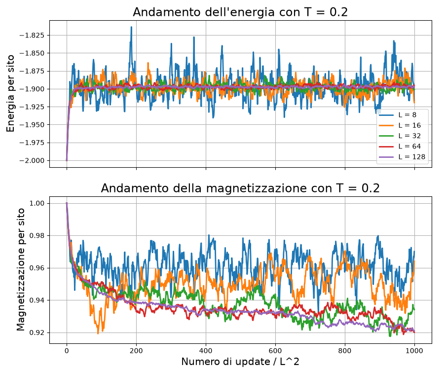
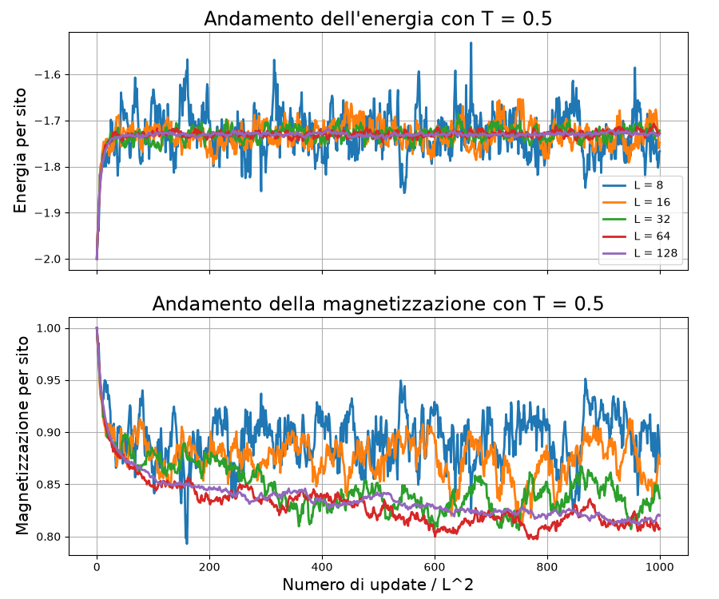
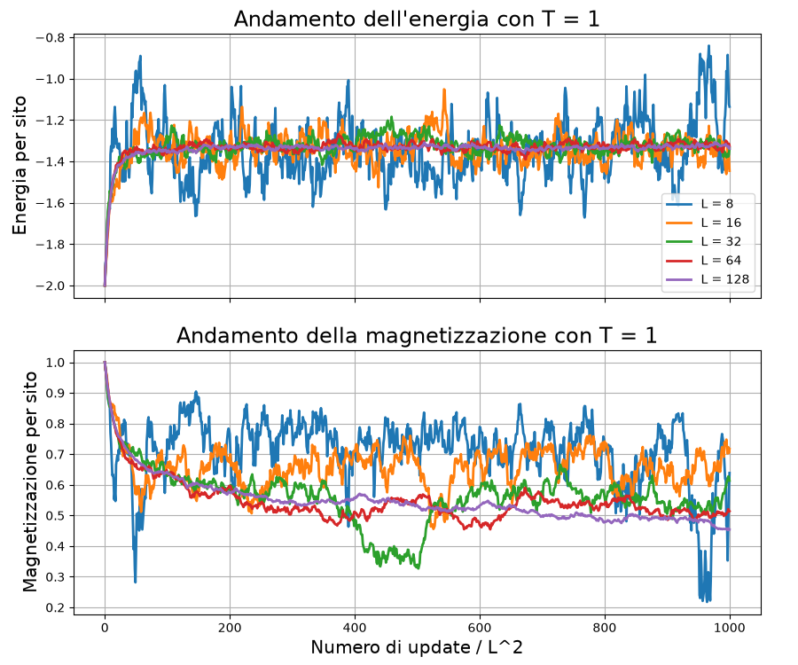
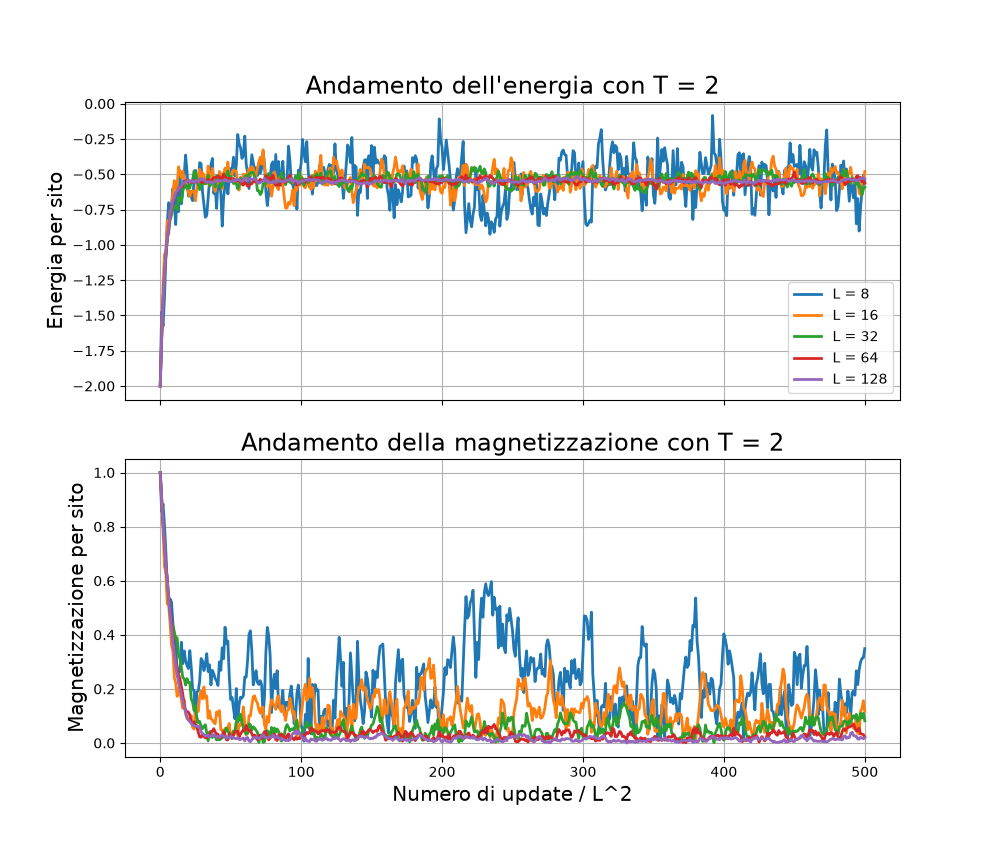
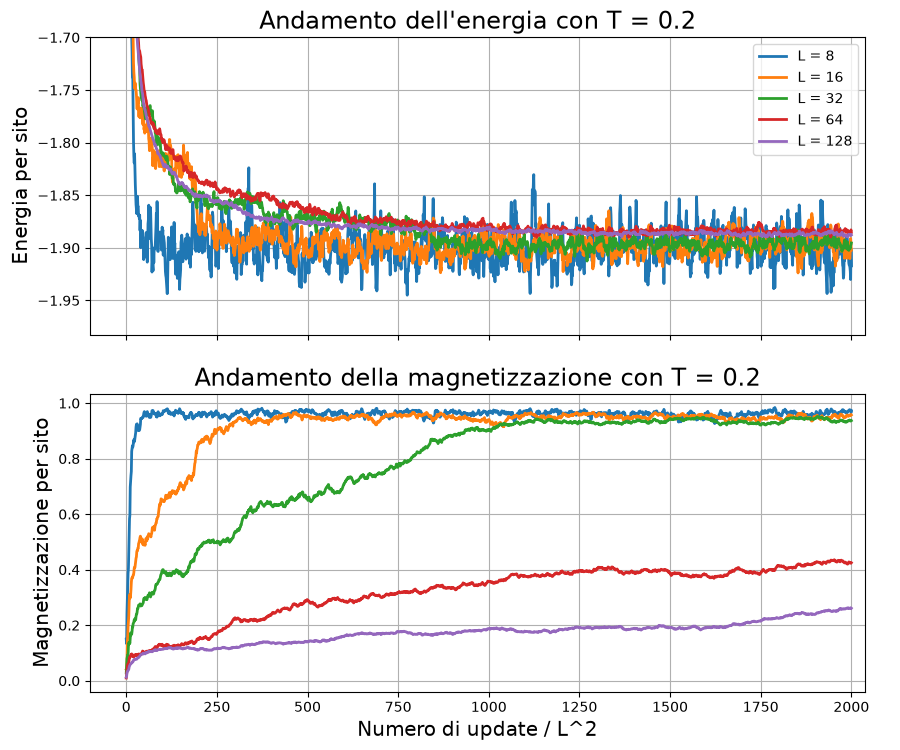
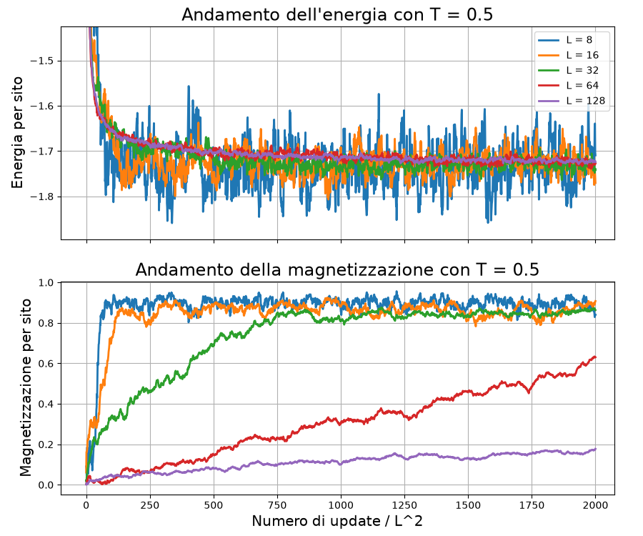
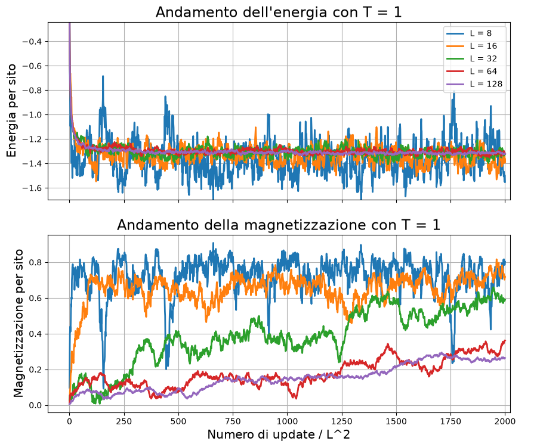
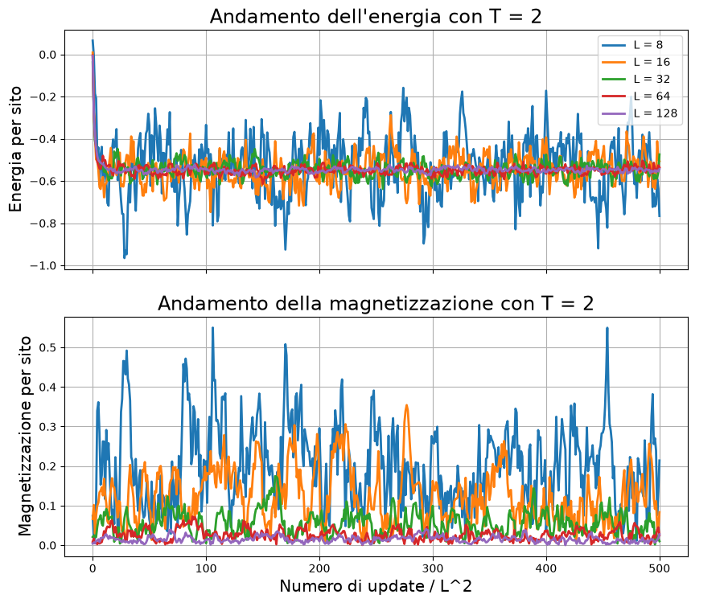

# Complementi di Fisica Computazionale: Il modello XY 2D

L'obbiettivo di questo complemento è la simulazione numerica del modello XY in due dimensioni 
tramite l'algoritmo Metropolis-Hastings.

In particolare siamo interessati alle misure di energia, magnetizzazione, calore specifico e 
suscettività magnetica. Queste misure vengono effettuate sulle configurazioni generate
dalla MCMC (Monte Carlo Markov Chain).

Sono state ripetute molte simulazioni variando sia le dimensioni del reticolo che la temperatura
del sistema.

## Termalizzazione

Prima di poter effettuare le misure è necessario assicurarsi che la configurazione abbia raggiunto
uno stato di equilibrio, dipendente dalla temperatura scelta. Questo può richiedere un numero di
steps diverso in base alla temperatura e alle dimensioni del reticolo. Per steps si intende un
numero di aggiornamenti locali di Metropolis pari al numero di siti totali, ovvero `L^2` per un
reticolo quadrato, con `L` la larghezza.  
Un'altro fattore che influenza il tempo di termalizzazione è il tipo di configurazione di partenza,
infatti sono possibili due configurazioni iniziali: *hot start* e *cold start*. Per *hot start* si
intende una configurazione iniziale in cui tutti gli spin sono scelti in maniera randomica. Invece
per *cold start* si intende invece una configurazione iniziale in cui tutti gli spin sono allineati
ad una stessa direzione. 
Qui di seguito sono riportati vari grafici dell'energia e della magnetizzazione.

### *Cold Start*

L'andamento dell'energia si stabilizza dopo 20-30 steps, mentre la magnetizzazione
impiega un numero maggiore di step per arrivare all'equilibrio. Non sembra esserci una forte relazione tra la larghezza del reticolo ed il tempo di termalizzazione. 
Da questi grafici si è scelto di aspettare 1000 step per la realizzazione dell'equilibrio da una partenza *cold start*.

### *Hot Start*

 

 

 

In questo caso la dipendenza dalla larghezza del reticolo è molto più evidente,
infatti nei reticoli più grandi si osserva come la configurazione di spin si può
assestare in uno stato meta-stabile con una energia di poco più alta dell'equilibrio.
Ciò è dovuto alla natura dell'algoritmo scelto, infatti questo ad ogni update cambia
un solo spin, ciò significa che per rompere il meta-equilibrio è necessario un grande
numero di tentativi. Si nota come anche la magnetizzazione abbia necessità di un
numero di step molto elevato per raggiungere l'equilibrio.

Per le simulazioni si è scelto di usare il *cold start* in quanto richiede un numero
minore di step di termalizzazione, come si può evincere dai graifici.